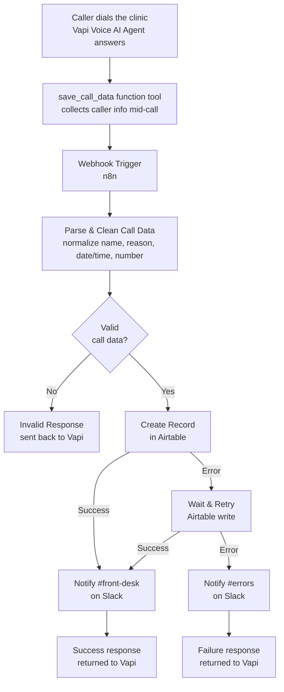

# AI Voice Clinic Receptionist — Vapi to Airtable to Slack

An **AI voice receptionist for medical and dental clinics** that answers phone calls, has a real conversation with the caller, and automatically logs every call — name, reason for calling, preferred appointment time, and callback number — into Airtable, with instant Slack alerts to the front desk. No call goes unlogged, and no front-desk staff member has to sit and transcribe calls by hand.

Built with **Vapi** (voice AI agent), **n8n** (workflow automation), **Airtable** (call/lead database), and **Slack** (team notifications).

## Overview

| | |
|---|---|
| **What it is** | A voice AI phone agent that answers incoming clinic calls, collects the caller's details through natural conversation, and automatically creates a structured record in Airtable with real-time Slack notifications. |
| **Who it's for** | Clinics, dental offices, and small healthcare practices that get a steady stream of phone calls for bookings, reschedules, and general questions, and don't want calls missed or scribbled on sticky notes. |
| **Problem it solves** | Front-desk staff can't always answer every call, and manually logging caller details into a spreadsheet or CRM is slow, inconsistent, and easy to forget during a busy shift. |
| **What makes it different** | The voice agent itself extracts structured data mid-conversation (not just a transcript dump afterward), validates it before it ever touches your database, and automatically retries and flags failures instead of silently losing a call's details. |

## How it works

A caller dials the clinic's number → Vapi's voice AI agent has a natural conversation, collecting the caller's name, reason for calling, preferred date/time, and callback number → that data is sent to n8n via a function-tool webhook → n8n validates and normalizes it → a new record is created in Airtable → the front desk gets an instant Slack notification. If anything fails along the way, it's retried once automatically and then escalated — never silently dropped.

## Why a voice AI agent instead of a static phone tree

Traditional IVR menus ("press 1 for appointments") can't actually talk to a caller, and a human receptionist can't always pick up every call during peak hours. A voice AI agent built on Vapi has a real back-and-forth conversation — asking for a caller's name, clarifying whether they want a new appointment or a reschedule, and asking for a callback number — the same way a front-desk staff member would, then hands off clean, structured data automatically instead of leaving behind only a raw audio recording someone has to listen to later.

## Features

### Call intake and structured data capture
- Vapi's voice AI agent answers calls and conducts a natural scheduling conversation.
- A dedicated function tool (`save_call_data`) captures caller name, reason for call, preferred date/time, and callback number directly from the conversation — no manual transcription needed.
- Handles both mid-call tool invocations and end-of-call summary reports, so data capture isn't dependent on a single event type.

### Validation before anything touches Airtable
- Confirms the incoming payload is a genuine call event before processing it.
- Normalizes the reason for calling into consistent categories (New Appointment, Reschedule, General Inquiry) regardless of how the caller phrased it.
- Falls back to sensible defaults ("Not provided") for any field the caller didn't give, rather than leaving a record malformed.

### Airtable integration
- Every call becomes a structured record with caller name, reason, requested date/time, callback number, call status, and a transcript/summary.
- Call status is automatically set to **New**, **Needs Follow Up**, or **Booked** based on what information was actually collected — incomplete calls are flagged for staff to call back, not quietly filed away.

### Reliability
- A failed Airtable write is automatically retried once before being escalated, so a brief API hiccup doesn't cost you a caller's details.
- A dedicated error path catches genuine failures and reports them separately from normal "needs follow-up" calls.

### Notifications
- Successful calls post an instant summary to a **#front-desk** Slack channel, so staff see new bookings and follow-ups in real time.
- Failures are posted to a separate **#errors** channel so technical issues get noticed immediately, without burying them in regular call notifications.

## Edge cases and how they're handled

| Situation | Behavior |
|---|---|
| Caller hangs up before giving their name or number | Record is still created, with "Not provided" fields and status set to **Needs Follow Up** |
| Caller doesn't give a clear reason for calling | Normalized to **General Inquiry** rather than left blank |
| No preferred date/time given | Defaults to "Not provided" instead of blocking the record |
| Airtable is briefly unavailable | Write is retried automatically once before anything is flagged as failed |
| Retry also fails (genuine outage) | Routed to **#errors** on Slack instead of failing silently |
| Vapi sends a malformed or non-call payload | Rejected before reaching Airtable, with a safe response sent back |
| Call data arrives via the live function tool vs. the end-of-call summary | Both event shapes are recognized and normalized to the same record format |

## Roadmap

- Direct calendar integration so "Booked" calls create an actual appointment slot, not just a status flag.
- SMS confirmation sent to the caller after a successful booking.
- Multi-location support for clinics with more than one front desk/Airtable base.
- A lightweight call analytics view (call volume, common reasons, follow-up rate).

## Tech stack

| Technology | Purpose |
|---|---|
| Vapi | Voice AI agent — answers calls, converses naturally, and extracts caller data via a function tool |
| n8n | Workflow orchestration — receives, validates, and routes call data |
| Airtable | Structured call/lead database with status tracking |
| Slack | Real-time front-desk and error notifications |

## Getting started

### Prerequisites
- A Vapi account with a configured voice assistant and phone number
- An n8n instance (self-hosted or cloud)
- An Airtable base with a Calls table (caller name, reason, date/time, callback number, status fields)
- A Slack workspace with a front-desk channel and an errors channel

### Setup
1. Import the workflow JSON into n8n (Workflows → Import from File).
2. Connect your Airtable and Slack credentials in n8n.
3. In Vapi, add the `save_call_data` function tool to your assistant and point its Server URL at your n8n production webhook.
4. Update your assistant's system prompt to require it collect all four fields and call `save_call_data` before ending the call.
5. Publish/activate the n8n workflow so the production webhook is live.
6. Make a real test call to confirm a record lands correctly in Airtable and a notification appears in Slack before relying on it for live calls.

## Design principles

- **Fail toward a human, never toward silence.** Any call missing information is flagged as **Needs Follow Up** rather than dropped or guessed at.
- **Never mark a call as Booked automatically.** Status only becomes Booked when a booking is explicitly confirmed — the workflow doesn't assume.
- **Retry before escalating.** Transient failures get one automatic retry; only genuine failures interrupt staff via the errors channel.

## FAQ

**Does this automatically book appointments?**
No. It logs every call with the caller's requested date/time and marks it for staff review. Actual calendar booking is on the roadmap but isn't automatic today.

**What happens if the AI mishears or misses the caller's name or number?**
The record is still created with whatever was captured, and missing fields default to "Not provided" with the call status set to Needs Follow Up, so staff know to call the person back.

**Can this handle more than one clinic location?**
Not yet in a single workflow — each location currently needs its own Vapi assistant and Airtable base. Multi-location support is on the roadmap.

**What if Airtable or Slack is temporarily down during a call?**
The Airtable write is retried automatically once. If it still fails, the failure is posted to a dedicated Slack errors channel instead of being lost.

**Does this replace the front-desk staff entirely?**
No — it's designed to make sure no call goes unanswered or unlogged, and to hand staff clean, structured information so they can follow up quickly, not to replace human judgment in patient care.

## License

License information will be added when the project is formally licensed.
